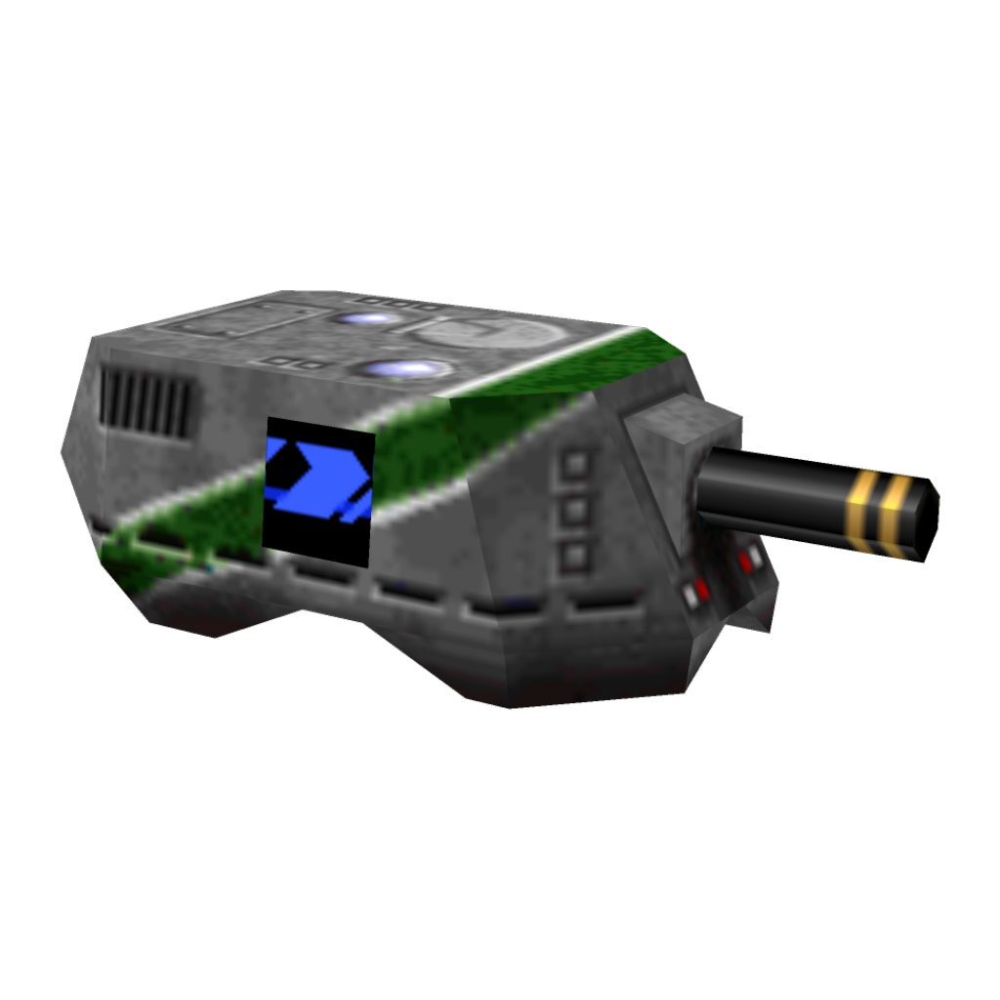

# Gunmetal asset toolkit

<p align="center">
  
</p>

Инструментарий для разбора и конвертации ресурсов игры **Gunmetal** (1998,
Mad Genius Software) — DirectX-сборка `gundx.exe` (v1.36). Это не декомпиляция
движка: форматы восстановлены по дизассемблеру `gundx.exe` и проверены на
реальных данных (побайтовое совпадение до EOF, попадание индексов в диапазон,
сверка с эмулятором x86 для видеокодека). Цель — чтение/конвертация активов, а
дальше и сборка обратно (моддинг).

Игра **только читается**: ничего в каталоге установки не изменяется, результаты
пишутся в отдельный каталог.

## Требования

* Python 3.11+ (проверено на 3.14), **только стандартная библиотека** —
  внешних зависимостей нет (`pip`/`PIL`/`numpy` не нужны; PNG/BMP-кодеки
  написаны вручную поверх `zlib`).
* Каталог установки Gunmetal (например `D:\games\Gunmetal 3dfx`; в WSL —
  `/mnt/d/games/Gunmetal 3dfx`).

## Состав

```
gm.py                 единый CLI (все команды ниже)
regress.py            сквозная регрессия по установке
gm/                   модули по форматам:
  bigfile.py          архивы BIGFILE (.idx + .dat)
  sbm.py              текстуры/спрайты .sbm
  sbc.py              лайтмапы уровня .sbc
  sob.py              модели .sob (и таблицы .soe)
  soa.py              анимации .soa
  sog.py              песни .sog (текстовые плейлисты)
  sou.py              звук .sou (контейнер архива SOU.DAT)
  sbv.py              видео .sbv (контейнер + собственный кодек, чтение и запись)
  sbw.py              мир/геометрия .sbw
  sbt.py              мир/уровень .sbt (скомпилированная «World Things file»)
  sbtvm.py            скриптовая ВМ SCRIPT (опкоды с именами, таблицы команд,
                      IF/ELSE/END, DEFINE_*-таблицы, декомпилятор)
  scene.py            сцена уровня из кода SCRIPT: свет, «места», предметы,
                      спрайты, звуки + таблица сущностей (статической
                      расстановки в .sbt нет; id дверей/переключателей на
                      геометрию в поставке не отображаются)
  sml.py              разметка интерфейса .sml и закодированные брифинги .sme
                      (шифр + семантика тегов по диспетчеру движка,
                      декодер/энкодер + извлечение текста)
  soe.py              сущности .soe (текстовая схема «thing»)
  look.py             таблицы поиска LOOK16.TAB / LOOK162.TAB
  render.py           софт-рендер моделей/уровней в PNG (камера, z-буфер,
                      планарные UV, текстуры из PICS/sprites)
  sou.py              контейнеры .sou; SOU0 PCM, SOU1 ADPCM, SOU2 формат 4
  sou2.py             декодер SOU2 «формат 4» (13 подпотоков, level 2/3)
  palette.py, bmp.py, png.py   палитра и вывод изображений
tools/gen_sbtvm.py    генератор gm/sbtvm.py из exe (правь его, не вывод)
tools/avatar.py       аватар из модели .sob: суперсэмплинг, билинейные текстуры,
                      свет, круглая подложка + PNG с прозрачностью; стиль
                      «ingame» — палитра GAMEPAL, авто-UV и свет движка,
                      контактный лист ракурсов
tools/re/             инструментарий реверса exe (PE-карта, дизасм, xref,
                      таблицы команд, эмулятор x86) — см. tools/re/README.md
tools/fuzz_formats.py фазз-матрица парсеров (пустые/битые/мутированные файлы)
tools/parity_sou2.py  Python↔C++ паритет SOU2 (--fast/--quick/полный архив)
tools/gen_sou2_table.py  извлечение gain-таблицы 0x852340 из sou2.cpp
tools/parity_config.py   round-trip GUNMETAL.CFG/CONTROLS.CFG + сверка .key
tools/parity_mip.py      golden-хеши рендера + mip/bilinear/alpha-режимы
tools/parity_film.py     .sof/.fdx round-trip, тайлы, палитра, привязка
docs/FORMATS.md       спецификации форматов (главный документ)
docs/RENDER.md        конвейер рендерера C++, паритет с вьювером, FPS
docs/SECURITY.md      границы доверия: лимиты парсеров, --force, фаззинг
docs/CONFIG.md        GUNMETAL.CFG: карта полей, xref, CONTROLS.CFG
docs/MIPMAPS.md       mip/bilinear/alpha в Python-рендере, доказательства Glide
docs/FILM.md          .sof/.fdx: тайлы, тайминг, привязка к оружию/экранам
                      C++-читатель + --film
docs/PLAYER.md        спавн игрока, DM-респавн, высота глаза, камера
docs/CAMERA.md        базис первого лица, проекция, xref 0x41e025
docs/SAVE.md          сейвы: контейнер, блоки, byte-exact rebuild
docs/SOU_CONTAINER.md .sou: статистика, 4091/4091 rebuild, аномалии
docs/VM_EXEC.md      SCRIPT-VM: исполнение 199 опкодов, 36/36
docs/VM_CPP.md       C++ SCRIPT-VM: 199 опкодов, 36/36, 391 spawns
docs/NESTED_THINGS.md сцена: 4008 top-level / 7563 recursive / 7617 executed
docs/SBT_RECORDS.md  .sbt: 38/38 файлов, 289 структурных записей
docs/SBV.md          .sbv: YUV-кодек, 6843/6843 кадров
docs/UI.md           SML/SME: 300 файлов, теги, экраны, HUD-ассеты
docs/SML_CPP.md      C++ SML/SME: structured reader, 299/300 golden
docs/SOE_CPP.md      C++ .soe/THING_TYPES: 77 полей, railrock 67/67
docs/HUD_CPP.md      C++ HUD: .sof блит, палитра, прозрачность, golden
docs/HUD_PLAYER.md   HUD-фильмы: .fdx/91 Гц, loop/hold, golden
docs/SHAKE.md        тряска камеры, view-pitch, отдача
docs/SAVE_FIELDS.md  сейвы: карта 128 полей (83 proven), xref
docs/SAVE_CPP.md     C++-читатель сейвов: контейнер, блоки, player 9
docs/SAVE_WRITER.md  C++-писатель сейвов: 2/2 byte-exact, правка полей
docs/RECORDS.md       SECTOR_STUFF/ITEM/LIFT: поля, xref, writer
docs/SOE.md           .soe/THING_TYPES: 77 полей, 36 proven, xref
docs/SOO.md           .soo: mode/loop, тики 91 Гц, морфинг поз
docs/SOB.md           .sob writer: canonical/raw, --rebuild, правка вершины
ROADMAP.md            план: от текущего тулкита до полного движка (M0…M12)
CURRENT_STATE.md      фактический срез прогресса, затраченное время и переоценка
NOTES.md              рабочие заметки, карта адресов движка, CLI-справка
```

## Быстрый старт

```bash
# что внутри архива
python3 gm.py list "…/PICS/SBM.IDX"

# стартовые точки игрока и DM из .sbt
python3 gm.py spawn "…/Gunmetal 3dfx/level0.sbt" --json

# камера первого лица из спавна (level0, slot 0)
python3 gm.py view "…/Gunmetal 3dfx/level0.sbw" --spawn --size 640 --out spawn.png

# поза .soo-анимации на 1000 мс (морфинг двух кадров)
python3 gm.py view "…/Gunmetal 3dfx/Sobanim/Cultist.soo" --at 1000 --out pose.png
# то же в C++
gunmetal --anim Cultist --at 1000 --width 240 --height 240 --render pose.png

# все текстуры и спрайты в PNG (палитра берётся из установки)
python3 gm.py textures "…/Gunmetal 3dfx" out/textures
python3 gm.py sprites  "…/Gunmetal 3dfx" out/sprites --transparent 0

# звуки: WAV для SOU0 (сырой PCM), SOU1 (ADPCM) и SOU2 (формат 4)

python3 gm.py sounds   "…/Gunmetal 3dfx" out/sounds

# контейнер .sou: статистика и byte-exact rebuild
python3 gm.py sou "…/Gunmetal 3dfx/sounds/SOU.IDX" --stats
python3 gm.py sou "…/Gunmetal 3dfx/sounds/SOU.IDX" --rebuild out/sou

# музыка: 3092 записи MUSIC/SOU.IDX -> WAV (формат 4, Python-декодер)
python3 gm.py music    "…/Gunmetal 3dfx/MUSIC/SOU.IDX" out/music
python3 gm.py music    "…/Gunmetal 3dfx/MUSIC/SOU.IDX" out/music --limit 10

# repack архивов: собрать из каталога или заменить одну запись
python3 gm.py extract  "…/Gunmetal 3dfx/sprites/SBM.IDX" out/raw
python3 gm.py pack     out/SBM.IDX out/raw --ext .bin
python3 gm.py set      "…/Gunmetal 3dfx/sprites/SBM.IDX" HERO01 new.bin out/mod.IDX

# правка текстуры: .sbm -> PNG -> правка -> .sbm -> в архив
python3 gm.py sprites  "…/Gunmetal 3dfx" out/sprites --transparent 0
python3 gm.py sbm      out/sprites/HERO01.png out/HERO01.sbm --game "…/Gunmetal 3dfx" --flags 257
python3 gm.py set      "…/Gunmetal 3dfx/sprites/SBM.IDX" HERO01 out/HERO01.sbm out/SBM.IDX

# модели и геометрия уровня
python3 gm.py sob      "…/Gunmetal 3dfx/SOBS" out/models
python3 gm.py sbw      "…/Gunmetal 3dfx"/*.sbw --obj out/levels
python3 gm.py sbw      "…/Gunmetal 3dfx"/*.sbw --rebuild out/levels_rebuilt   # правка геометрии

# просмотр: софт-рендер модели/уровня в PNG (с текстурами из PICS)
python3 gm.py view     "…/Gunmetal 3dfx/SOBS/kingtest.sob" --out out/view --size 640 --sheet
python3 gm.py view     "…/Gunmetal 3dfx/SOBS" --out out/view --size 256 --game "…/Gunmetal 3dfx"
# вид изнутри уровня: ручная камера + отсечка по дальности + материалы
python3 gm.py view     "…/Gunmetal 3dfx/dm1.sbw" --out out/view --size 640 \
                       --pos 0,0,20 --look 60,60,20 --clip 200 --cull
# лайтмапы уровня берутся из <уровень>.sbc автоматически (--no-lightmap, --ambient N)
# инспекция одной комнаты: --sector N (--no-sectors выключает отсечку по пирамиде)
python3 gm.py view     "…/Gunmetal 3dfx/dm1.sbw" --out out/view --size 640 --sector 2
# сцена уровня из кода SCRIPT: маркеры света/мест/предметов/звуков + их освещение
python3 gm.py scene    "…/Gunmetal 3dfx/dm1.sbt"
python3 gm.py view     "…/Gunmetal 3dfx/dm1.sbw" --out out/view --size 640 \
                       --scene --scene-lights

# уровни: таблицы handle + сверка с соседним .sbw
python3 gm.py sbt      "…/Gunmetal 3dfx" --resolve -v
python3 gm.py sbt      "…/Gunmetal 3dfx" --rebuild out/levels_rebuilt   # запись обратно
python3 gm.py sbt      "…/Gunmetal 3dfx/dm1.sbt" --script                # декомпиляция SCRIPT
python3 gm.py sbt      "…/Gunmetal 3dfx" --script --script-out out/scripts

# прочее
python3 gm.py sml      "…/Gunmetal 3dfx/SML" out/sml # брифинги и UI: sml/ + txt/
python3 gm.py soa      "…/Gunmetal 3dfx"            # анимации
python3 gm.py soe      "…/Gunmetal 3dfx"            # «thing»-определения
python3 gm.py look     "…/Gunmetal 3dfx/LOOK16.TAB" --png look16.png --palette "…/FLAG/naUSA.BMP"
python3 gm.py sog      "…/Gunmetal 3dfx/MUSIC" --music "…/Gunmetal 3dfx/MUSIC/SOU.IDX"
python3 gm.py sbv      "…/Gunmetal 3dfx/Vid/Intro.sbv" --png out/intro --frames all
python3 gm.py sbv      "…/Gunmetal 3dfx/Vid/Intro.sbv" out/intro_raw   # сырые блоки + frames.txt
python3 gm.py sbv      out/intro_raw out/intro.sbv                     # собрать клип обратно
```

Запись обратно (repack) поддерживают команды `pack`/`set` (архивы), `sbm`
(PNG/BMP → текстура) и флаг `--rebuild DIR` у `sbw`, `sbt`, `sbc`, `soa`, `soe`,
`sog`, `sml`, `sbv` — файлы собираются побайтово точно (у `sml` — 150 из 151
`.sme`; `brief/level17.sme` в поставке повреждён и собирается исправленным,
см. §14 FORMATS; у `sbv` — контейнер + пиксельный кодек, 6843/6843
кадров pixel-exact); всё это
проверяется в `regress.py`.

Список всех команд: `python3 gm.py --help`, справка по команде —
`python3 gm.py <команда> --help`.

## Статус форматов

| Формат | Что это | Статус |
|---|---|---|
| BIGFILE `.idx`/`.dat` | архивы (PICS, sprites, sounds, FRONTEND, MUSIC) | разобран; **repack** (чтение+запись, по-байтово точно) |
| `.sbm` | 8-битные текстуры/спрайты | разобран; **кодировщик** (blob round-trip побайтово; PNG/BMP→.sbm) |
| `.bmp`, палитра | общая VGA-палитра из BMP; вывод PNG | разобран |
| `.sob` | модели (672 файла) | разобран; **рендер в PNG** (`gm.py view`, текстуры из PICS) |
| `.sbc` | уровневые градационные карты (51 файл) | разобран (побайтово); **писатель** |
| `.soa` | анимации (104 файла) | разобран; **писатель** |
| `.soe` | «thing»-определения (текст) | разобран; **писатель** |
| `.sog` | песни (651) | разобран; **писатель** |
| `.sou` | контейнер звука (999 + 3092 записи) | SOU0/1/2 декодируются в Python и C++ (983/983, 3092/3092) |
| `.sbv` | видео (Intro/orient/winner) | разобран полностью, включая кодек (сверка с эмулятором); **писатель контейнера** (rebuild побайтово, 3/3) |
| `.sbw` | мир: геометрия + поля полигонов/объектов | разобран (36/36 до EOF); **писатель** (rebuild побайтово); **рендер в PNG** (`gm.py view`) |
| `.sbt` | мир/уровень (World Things file) | разобран (36/36; handle сверены с `.sbw`); **писатель** (rebuild побайтово, структурные записи 205/205); **скриптовая ВМ SCRIPT** разобрана — имена опкодов (в т.ч. `DEFINE_WEAPONS`/`DEFINE_AMMO`/`DEFINE_EQUIPMENT`/`DEFINE_PLAYER_TYPES`/`DEFINE_LEVEL_OBJECTIVES`/`ADD_LIFT`/`SOURCEPLAYER_PATH`, `IF`/`ELSE`/`END`), декомпилятор, 36/36 в байтовый конец |
| `LOOK16.TAB`/`LOOK162.TAB` | кубы 64³ «6-6-6 RGB → индекс палитры» | разобран |
| `LVLNAMES.SLU` | таблица имён уровней (`СТВОЛ Имя`, ASCII+CRLF) | разобран вручную (загрузчик `0x48b3f0`); секретные уровни (`secrt1`/`secrt2`), карта кампании/DM-цепочек и патчевый DM5 `temple` — §15 в `docs/FORMATS.md` |

Детали и точные структуры — в `docs/FORMATS.md`; карта адресов движка — в
`NOTES.md`.

## Регрессия

```bash
python3 regress.py            # быстрые проверки (парсинг всех уровней и т.д.)
python3 regress.py --full     # плюс распаковка текстур/спрайтов/звуков/frontend
python3 regress.py --game "…/Gunmetal 3dfx" --out /tmp/opencode/regress
```

Скрипт прогоняет `gm.py` по всем семействам данных и сверяет итоговые строки
(количества и «0 failed»). Ненулевой код возврата — регрессия. Всё пишется в
`--out` (по умолчанию `/tmp/opencode/regress`), каталог игры не трогается.

## Заметки

* Тяжёлые операции (распаковка, конвертация) лучше выполнять в Linux-доме или
  `/tmp`, а не на медленных монтированиях `/mnt/c`/`/mnt/d`.
* `gun.exe` — DOS/4GW-сборка (нужен отсутствующий `GLIDE2X.OVL`); играбельная —
  `gundx.exe`, она и служит источником для дизассемблирования.
* Секретные уровни: `secrt1` (Foundry) и `secrt2` (Processor) открываются
  скрытыми «прыжковыми воротами» в `level4`/`level16`; `temple` (DM5) добавлен
  патчем 1.36 и играется только в deathmatch. Кампания идёт через штабы-хабы
  (`level00`/`level000`/`level0a`, финальный акт — `level0b`/COMMAND POST), а
  DM-классик — сквозная цепочка по боевым картам. Подробности и полная таблица
  переходов — §15 FORMATS, инструмент `tools/re/campaign.py`.
* Модель крафта игрока выбирается **по имени**: шасси из `DEFINE_PLAYER_TYPES`
  называет ресурс (`tick`, `devsttr`, …), инженерный резолвер `0x47c940` ищет его
  в `SOB_TABLE` уровня, а `0x452240` подменяет модель игрока. Поэтому все 36
  уровней несут восемь моделей шасси по одним индексам (15–18 и 21–24), а
  бонусное шасси `57 CHEVY` переиспользует тяжёлый корпус — `SOBS/Chevy.sob` не
  используется нигде (`tools/re/chassis_models.py`, §12.3 FORMATS).
* Геометрия сущностей найдена: в записи `THING_TYPES` (`.sbt`) поле `+0x1a4` —
  индекс модели в `SOB_TABLE`, так что цепочка «сущность скрипта → объект → тип
  thing → модель» замкнута; `…x`-корпуса оказались обломками (не «второй формой»)
  — `tools/re/thing_models.py`, §12.2 FORMATS.
* Таблица сущностей `SCRIPT` читается до конца: её третья колонка — смещение
  **подскрипта** сущности в том же коде (15 025/15 061 блоков стыкуются точно), а
  сам подскрипт через `ADD_THING*` задаёт тип вещи (`4005/4005` валидны) —
  полный путь `GENERATE id → подскрипт → THING_TYPES → +0x1a4 → модель`
  (`tools/re/entities.py`, §12.4 FORMATS).
* Вещи собраны в сцену: **4008** штук в 36 уровнях (2844 с абсолютной позицией,
  138 моделей `SOB`), и они ставятся в просмотрщике —
  `gm.py view <уровень.sbw> --game DIR --things` (плюс `--thing-scale`,
  `--no-background`); кадр проверен односторонним аргументом (медиана отношения
  размахов «вещи / геометрия» = 1.12 по 35 уровням).
* Двери, переключатели и лифты тоже читаются из кода: 1779 / 3964 / 45 на все
  уровни; id сущностей, дверей и переключателей — одно пространство, а позиция
  переключателя (операнды 4..6) проверена по геометрии уровня на 94.7%
  (`tools/re/doors.py`, §12.4 FORMATS).
* Найдена и исправлена ошибка генератора таблиц: имена 59 условий в `gm/sbtvm.py`
  были сдвинуты на строку (`tools/gen_sbtvm.py` читал таблицу с `0x4b62ec`
  вместо `0x4b62e8`); сигнатуры и все размеры декодирования не менялись.
* Трансформ объекта `.sbw` теперь применяется точно: `world = origin + basis·local`
  (в поставке базис `diag(1.875)`, origin ≤ 8), `view --transform` ставит объекты
  в мир движка, UV сохраняются (`Object.world_vertices`, `render.PlacedMesh`).
* Символы/структуры модулей менять свободно — это внутренний инструмент, обратная
  совместимость не требуется.
