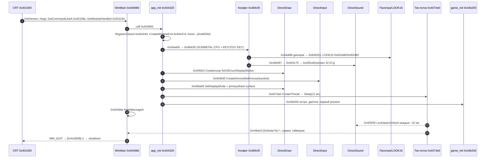

# Инициализация движка: WinMain → видео → звук → ввод → конфиг → палитра (M2.2.1)

**Статус:** карта собрана по `gundx.exe` v1.36 (v1.93 CFG, ImageBase `0x400000`)
без запуска игры: дизассемблер `objdump` + Ghidra (`tools/ghidra/mcp.py`).
Каждый шаг ниже проверяется машинно: `tools/re/init_flow.py --verify` сверяет
адрес, байты инструкции и слот импорта, `--self-test` проверяет сам верификатор
на синтетическом PE. Главный цикл и state machine — `docs/MAINLOOP.md`
(не дублируется), форматы — `docs/FORMATS.md`, инструменты Ghidra — `docs/GHIDRA.md`.

Пометки: **код** — подтверждено байтами (адрес в скрипте проверки),
**гипотеза** — вывод декомпилятора без байтового подтверждения.

## 1. Вся цепочка в одну строку

```
0x401000 CRT entry
  → 0x404680 WinMain
      → 0x404320 app_init: /net-диалог, RegisterClassA(0x404440) + CreateWindowExA(0x40447d)
          → 0x44a460 game_preinit: лог → bigfile → дефолты → GUNMETAL.CFG(0x484cf0) → CLI →
                                   шрифты/скрипты → видеорежим → GAMEPAL+LOOK16 → DirectSound
          → 0x405fc0 ddraw_preinit: DirectDrawCreate → QI(IDirectDraw2) → coop 0x53 → EnumDisplayModes
          → 0x404b00 dinput_init: DirectInputCreateA → клавиатура → мышь → EnumDevices(джойстики)
          → 0x406a80 ddraw_init: SetDisplayMode → CreateSurface(primary+1 back) → GetAttachedSurface
          → 0x4074a0 timer_thread: CreateThread(11 мс) → milisec(GetLocalTime) + миксер звука + тик
          → 0x44b200 game_init: фронтенд-картинки → интро → game_change_videomode → первый present
      → 0x4046be цикл PeekMessage/DispatchMessage (docs/MAINLOOP.md §1)
          → 0x44c230 кадр; WM_QUIT → 0x407550 → 0x44b460 / 0x406eb0 / 0x405ed0 / 0x405a40
```



## 2. Точка входа и CRT

| шаг | адрес | что |
|---|---|---|
| `AddressOfEntryPoint` | `0x401000` (RVA `0x1000`) | пролог `55 8b ec` |
| `GetVersion` | `0x401026` | версия DOS/Windows → `0x4bee40/44/48/4c` |
| инициализация heap/argv | `0x402020`, `0x402120` | CRT `_heap_init` / `_setargv` |
| `GetCommandLineA` | `0x40108e` | `[0x840b6c]` |
| `GetStartupInfoA` | `0x401125` | `nCmdShow` (по умолчанию 10) |
| `GetModuleHandleA` | `0x401146` | hInst |
| `call WinMain` | `0x40114d` | `e8 2e 35 00 00` → `0x404680`, `ret 0x10` |
| `ExitProcess(ret)` | `0x401156` → `0x401210` | код возврата WinMain |

`WinMain` (`0x404680`) не содержит логики: единственный `call 0x404320`
(`0x404692`), при нуле возвращает `-1` (`0x404732`), иначе — цикл сообщений
`0x4046be` (см. `docs/MAINLOOP.md`).

## 3. Окно (0x404320)

1. **Разбор командной строки** `0x404336..0x4043be`: ищутся 8 написаний `/net`
   (`0x4a5ad4`, `/Net`, `/NET`, …); флаг ставится только при «голом» `/net`
   (следующий символ — пробел/таб/CR/LF, `0x4043c0..0x4043d7`) → `[esp+0xc]`.
2. `LoadCursorA(0, IDC_ARROW=0x7f00)` `0x4043e5`, `LoadIconA(0, IDI_APPLICATION=0x7f00)` `0x4043f5`,
   `GetStockObject(DKGRAY_BRUSH=4)` `0x404411`.
3. `WNDCLASS` на стеке: `style=3` (`CS_HREDRAW|CS_VREDRAW`, `0x404428`),
   `lpfnWndProc=0x404070` (`0x404430`), `hInstance=hInst`, `lpszClassName` и
   `lpszMenuName` — одна и та же строка `0x4a5980` `"FSDSClass"`.
4. `RegisterClassA` `0x404440`; `0` → возврат `0` (WinMain вернёт `-1`).
5. `CreateWindowExA(0, "FSDSClass", "FSDS Direct X Game", WS_POPUP=0x80000000,
   0, 0, GetSystemMetrics(0), GetSystemMetrics(1), 0, 0, hInst, 0)` `0x40447d`.
6. `ShowWindow(1)` `0x40448b`, `UpdateWindow` `0x404492`.
7. `[0x4bf294] = hwnd` `0x404498` — **единственный** hwnd, его получают
   `DirectDraw SetCooperativeLevel`, `DirectInput SetCooperativeLevel`,
   `DirectSound SetCooperativeLevel` и `MessageBoxA`.
8. `0x404630`: `GlobalMemoryStatus` (`0x841324`) → `[0x4bf290] = (totalPhys-4000000)>>20`
   (МБ сверх 4 МБ; потребитель не локализован — **гипотеза**: размеры кэшей).
9. `/net` → `DialogBoxParamA(hInst, 0x66, hwnd, 0x404180, 0)` `0x4044b6`.
10. Если `[0x4bf298] != 0` — тип сетевого соединения, выбранный в диалоге
    `0x404180` (`1`/`3`/`4`, `0x4bf29c` = сервер/клиент, `0x4041e4..0x40426c`) → `0x407560`: `CoInitialize` +
    `CoCreateInstance` DirectPlay и перебор провайдеров IPX/TCP-IP/модем/COM
    (`0x4a66f0..0x4a67a0`).

## 4. Порядок подсистем и ветки ошибок

`0x404320` вызывает подсистемы строго последовательно; на каждом шаге ненулевой
`eax` = указатель на текст ошибки, который уходит в общий обработчик `0x4045e0`
(`MessageBoxA(hwnd, buf, "FSDS Direct X Game", 0x30)` по формату `0x4a5adc`
`"%s:\n%s"`, затем `DestroyWindow`).

| # | вызов | подсистема | сообщение при ошибке |
|---|---|---|---|
| 1 | `0x4044e2` → `0x44a460` | game_preinit (конфиг, палитра, звук) | `Game Pre-Initialization Failed` `0x4a5a54` |
| 2 | `0x4044f7` → `0x405fc0` | DirectDraw pre-init | `DirectDraw Pre-Initialization Failed` `0x4a5a2c` |
| 3 | `0x40450d` → `0x404b00` | DirectInput | `DirectInput Initialization Failed` `0x4a5a08` |
| 4 | `0x404539` → `0x406a80` | DirectDraw режим+поверхности | `DirectDraw Initialization Failed` `0x4a59e4` |
| 5 | `0x404569` → `0x4074a0` | тик-поток | `Timer Thread Initialization Failed` `0x4a59c0` |
| 6 | `0x40459c` → `0x44b200` | game_init (интро, present) | `Game Initialization Failed` `0x4a59a4` |
| 0 | `0x4044cd` → `0x407560` | DirectPlay (только `/net`) | `DirectPlay Server Initialization Failed` `0x4a5a74` |

Важно для порта: **конфиг и палитра загружаются до DirectDraw**, а
DirectInput — **до** создания поверхностей; тик-поток стартует **после**
DirectDraw и **до** первого кадра. Звук поднимается последним шагом
`game_preinit`, т.е. до DirectDraw.

## 5. Конфиг: `GUNMETAL.CFG`, `KEYCFG\*.KEY`, `path.sni`

Всё — одна функция `0x484cf0`, вызывается из `game_preinit` в `0x44a518`.

| шаг | адрес | детали |
|---|---|---|
| `path.sni` | `0x484d03` | альтернативный путь; ошибки `0x4bcd9c` / `0x4bcd7c`; при неудаче — баннер `"\n\nPlease insert %s CD in drive %s"` `0x4bcd58` |
| `open("GUNMETAL.CFG","rb")` | `0x484dd2`/`0x484e64` | `0x40dae0` = open, `0x40dc70` = read (0x2000 байт), `0x4035f0` = close |
| заголовок | `0x4bc380` | `"GUNMETAL Configuration File. av1.93\x1a"`; совпал → `[0x4aac7c]=1` |
| поля | стек `0x80..0x2000` | громкости `[0x4aac74]`/`[0x4aac78]`, режим → `0x83d944/0x83d630/0x83d190/0x83d314/0x83d2dc`, чувствительность мыши `[0x4aac38/40/48]` (×0.001, минимум 0.2), биндинги `0x4a5ae8/0x4a5af8` (16 пар), имена читов `0x4aa34c..0x4aa37c` |
| нет файла | `0x44a4ee` | дефолты `320x200x8` (`[0x83d944]=0x140`, `[0x83d630]=200`, `[0x83d190]=8`), пустые биндинги |
| профили | `0x4852e7` (`"KEYCFG\\*.KEY"`) → `0x404750` (FindFirst/Next) → `0x48533a` open | до 15 профилей; 9-байтовое имя сравнивается с конфигом (`0x415ff0` = memcmp), файл профиля 0x178 байт |
| сохранение | `0x485830`/`0x48583a` | `open("GUNMETAL.CFG","wb")` + write 0x2000; профиль — `"KEYCFG\\%.8s.key"` `0x4bcdd4` |

**CLI** разбирается в `0x44a460` после конфига (`0x44acxx`), полный текст помощи —
`0x4aac90`. Флаги и глобалы:

| флаг | глобал | смысл |
|---|---|---|
| `/net`, `/networkclient`, `/networkserver`, `/port N` | `0x4c1294`, локальные `local_60` | сеть (порядок 1/2) |
| `/l`, `/h` | `0x83d944/0x83d630` | 320×200 / 640×480 |
| `/glide`, `/nglide`, `/hw`, `/nhw` | `0x4a6170` (бит `0x800` = glide) | 3D-режимы |
| `/n` | `0x4aa384 = 0` | без звука |
| `/sb`, `/sbpro`, `/sb16`, `/sb32`, `/sb64` | `0x4ab308 = 1..3` (дефолт `-1` = авто) | драйвер звука |
| `/ev N`, `/mv N` | `0x4aac78`, `0x4aac74` | громкости (0..100 → ×20/100) |
| `/skill N`, `/hunt`, `/flag`, `/team`, `/nomonsters`, `/nobuyammo`, `/freeze`, `/handicap` | `0x678148`, `0x4abe6c…` | правила матча |
| `/i` | `0x4ab30c = 0` | без интро |
| `/bin`, `/sbm`, `/time`, `/log`, `/netlog`, `/god`, `/regen`, `/savefilm` | `0x5a4634`, `0x5a46dc`, `0x5a46d4`, `0x62c078`, `0x62cad4`, `0x5a46d8`, `0x5a4720` | отладка/сервис |
| `/ignorejoystick`, `/ignoremouse`, `/ignoreall` | `0x4bfc94`, `0x4bfcc8` | отключение ввода |
| `/sbm`, `/two`, `/thunderbird`, `/thunderpad`, `/spacepad` | `0x4bfc98`, `0x5a46f4` | тип геймпада |
| первый не-флаговый аргумент | `0x442a90` | сразу запустить уровень (сброс `[0x4ab30c]`, `[0x4bc440]=0`) |

## 6. Видео: DirectDraw

### 6.1 pre-init `0x405fc0`

```
0x405fd9  DirectDrawCreate(NULL, &[0x4c05d8], NULL)     ; thunk 0x4092ce
0x406000  QI(IID_IDirectDraw2 = 0x4a1858) → [0x4c05d8]
0x40601a  Release() исходного IDirectDraw
0x406030  SetCooperativeLevel(hwnd, 0x53)               ; EXCLUSIVE|FULLSCREEN|ALLOWREBOOT|ALLOWMODEX
0x40605d  EnumDisplayModes(3, 0, 0, cb=0x4065a0)        ; 5 dword/режим → [0x4bfd1c], счётчик [0x4c05bc]
0x406083  LoadLibrary("glide2x.dll") + glidelibinit     ; только если [0x4a6170]&0x800
```

Режимы фильтруются/сортируются по площади (`0x406081..`), в лог пишется
`0x4a6240…` при ошибках. Glide-ветка даёт отдельный набор 512×384/640×480/800×600
(`0x406b31..0x406b96`).

### 6.2 режим и поверхности `0x406a80` → `0x406ae0`

| шаг | адрес | детали |
|---|---|---|
| освободить старые объекты | `0x406c07`/`0x406c20` | `Release` primary (`0x4c05dc`) и палитры (`0x4c05e4`) |
| софт-кадр | `0x406c4a` (`0x402770`) | `[0x4c05e8] = malloc(w*h)` для 8bpp, `w*h*4` для 16/32 |
| `SetDisplayMode(w,h,bpp,0,0)` | `0x406d1c` (`+0x54`) | 320×200×8 — отдельная ветка (`param[4]&1 == 0`), 640×480×8/16 — с удвоением |
| `CreateSurface` | `0x406d8d` (`+0x18`) | `DDSURFACEDESC`: `dwSize=0x6c`, `dwFlags=0x21` (`CAPS|BACKBUFFERCOUNT`), `ddsCaps=0x218` (`PRIMARYSURFACE|COMPLEX|FLIP`), `dwBackBufferCount=1` → `[0x4c05dc]` |
| `GetAttachedSurface(DDSCAPS_BACKBUFFER=4)` | `0x406db9` (`+0x30`) | back buffer → `[0x4c05e0]` |
| fallback | `0x406a99` → `0x406ac4` | при ошибке повтор с `320×200×8` (`0x140/0xc8/8/0/0`) |

Активный режим дублируется в `[0x4c05c0..0x4c05d0]` (w,h,bpp,?,flags) и в
`[0x4a6178..0x4a6188]` (запрошенный режим). Ветка `flags & 0x800` — Glide
(рисование идёт через `0x4c04xx`-указатели, `0x406f60` использует
`0x4c04fc/0x4c04ec/0x4c05a4`).

### 6.3 кадр: копирование и flip `0x406f60`

```
0x406a11  Lock(back, NULL, &desc(0x6c), 0, 0) → ptr/pitch (0x4069f0, retry на DDERR_WASSTILLDRAWING)
0x40c580  построчный блит софт-кадра [0x4c05e8] → back;
          [0x4c05d0]&0x100 → удвоение строк (320×200 → 640×400)
0x406a6a  Unlock(back) (+0x80)
0x4069ad  Flip(primary, 0, 0) (+0x2c); DDERR_SURFACELOST 0x8876021c → Restore(+0x6c)
```

Палитра ставится на primary в том же `0x406f60`: если `[0x4c05f8] > 0` и
`[0x4c05e4] != 0` → `SetPalette` (`+0x7c`) и счётчик уменьшается (16 кадров
после каждой смены палитры).

## 7. Звук: DirectSound

Цепочка: `0x44b087` → `0x40c420([0x4ab308])` → `0x40b460` → (если `param != 0`)
`0x404170` → `0x405cd0(hwnd)`. Дефолт `[0x4ab308] = -1` («авто») — звук включён;
`/n` ставит `[0x4aa384]=0` и звук не поднимается вовсе.

| шаг | адрес | детали |
|---|---|---|
| `DirectSoundCreate(NULL,&[0x4bfd08],NULL)` | `0x405cdc` (thunk `0x4092c8`) | ошибка `Unable to directsoundcreate` |
| `SetCooperativeLevel(hwnd, 3)` | `0x405cfd` (`+0x18`) | `3 = DSSCL_EXCLUSIVE` |
| `CreateSoundBuffer(primary)` | `0x405d4b` (`+0x0c`) | `DSBUFFERDESC {dwSize=0x14, dwFlags=0x4001}`, объект `[0x4bfd0c]` |
| `GetFormat`/`SetFormat` | `0x405d6f` (`+0x14`), `0x405db1` (`+0x38`) | `WAVEFORMATEX`: 32000 Гц, 2 канала, 16 бит, `nBlockAlign=4`, `nAvgBytesPerSec=128000` |
| второй `DirectSoundCreate` | `0x405dbd` | объект `[0x4bfd00]`, тоже coop 3 |
| стрим-буфер | `0x405e69` (`+0x0c`) | `DSBUFFERDESC {dwSize=0x14, dwFlags=0x101e0, dwBufferBytes=0x10000}` → `[0x4bfd04]` |
| старт | `0x405ebb` (`+0x30`) | `SetCurrentPosition(0)`, `SetVolume(0)`, `Play(0,0,1)` — бесконечный цикл |
| подкормка | `0x405f30` | `Lock(+0x2c)` двух регионов, `GetCurrentPosition(+0x10)`, `call 0x4092e0` (ассемблерный миксер из секций `adpcmseg/mixasmda/mixasmse`), `Unlock(+0x4c)` |
| таблица сэмплов | `0x40b510("sounds\\sounds.sub")` | до 150 записей `%ld,%s,%s`, ошибка не фатальна |
| shutdown | `0x405ed0` | `Stop(+0x48)` + `Release` обоих объектов |

Миксер вызывается **из тик-потока** (`0x40751f` каждый второй тик, т.е. ~22 мс),
поэтому звук не зависит от кадров; критических секций в этой цепочке нет —
синхронизация только через `Lock/Unlock` буфера.

## 8. Ввод: DirectInput

| шаг | адрес | детали |
|---|---|---|
| `DirectInputCreateA(hInst, 0x500, &[0x4bfcf0], 0)` | `0x404b4a` (thunk `0x408fe8`) | версия 0x500 (DX5), ошибка `Direct Input Create failed` |
| клавиатура | `0x404b72` (`+0x0c`) | GUID_SysKeyboard → `[0x4bfcf4]` |
| формат клавиатуры | `0x404b92` (`+0x2c`) | `c_dfDIKeyboard` `0x408fd0` |
| coop клавиатуры | `0x404bb0` (`+0x34`) | `6 = FOREGROUND|NONEXCLUSIVE` |
| буфер событий | `0x404bf2` (`+0x18`) | `DIPROP_BUFFERSIZE = 0x20` |
| мышь | `0x404c20` (`+0x0c`) | GUID_SysMouse → `[0x4bfcf8]`, формат `0x407fb0`, coop `5 = FOREGROUND|EXCLUSIVE` (`0x404c5e`); `[0x4bfccc]=1` |
| джойстики | `0x404ce9` (`+0x10`) | `EnumDevices(4=GAMECTRL, cb=0x404d00, 0, ATTACHEDONLY=1)`, до 8 устройств → `[0x4bfca8+i*4]`, `[0x4bfca0]` = счётчик |
| создание джойстика | `0x404d35` (`+0x0c`) | QI на `IDirectInputDevice2` (`0x4a13b8`), `SetDataFormat(0x4092b0)` `0x404d89` |
| фокус | `0x4059c0` | по `WM_ACTIVATE`: активное окно → `Unacquire(+0x20)`, неактивное → `Acquire(+0x1c)`; флаг `[0x4a598c]` (docs/MAINLOOP.md §2) |
| опрос | `0x405450` — клавиатура/мышь, `0x404880` — джойстик | `GetDeviceData(+0x28)`/`GetDeviceState(+0x24)`, буфер 0x20 событий, состояние осей 0x50 байт; нажатия → `0x4bf2a8[code]`, колбэки `0x44bb50/0x44bce0` |
| shutdown | `0x405a40` | `Unacquire` + `Release` всех устройств |

Критические секции в DirectInput-пути не используются (импорт
`InitializeCriticalSection` принадлежит CRT), синхронизация — через тик-поток и
опрос в главном цикле.

## 9. Палитра и таблицы LOOK16

| шаг | адрес | детали |
|---|---|---|
| `GAMEPAL.BMP` | `0x44af88` → `0x47efe0("frontend","gamepal",…)` | читается 0x36 байт заголовка + 0x400 байт BGRA, компоненты `>>2` → 6-бит; результат в `[0x83d320]` (768 байт) |
| ошибка | `0x4abbb8` | `Unable to load game palette (FRONTEND\\GAMEPAL.BMP)` — фатальна |
| текущая палитра | `0x44afb3` | `[0x83d2c4] = 0x83d320` |
| `WATERPAL.BMP` | `0x44afbd` → `0x83d640` | при ошибке `0x41edd3(0x83d320,0x83d640)` — копия; предупреждение `0x4abb5c` |
| LOOK16 (dword) | `0x44b017..0x44b04a` | 256 dword в `[0x83cb80]`: `T_B[b<<4] + T_R[r<<4] + T_G[g<<4] + 0x2aa554aa` (таблицы `0x4a6e40`, `0x4a6a40`, `0x4a7240`, 64 записи × 16 байт) — упакованные 4 уровня затенения |
| LOOK16 (RGB555) | `0x44b04d..0x44b065` | 256 word в `[0x83cf80]`: `((g & 0x3e) << 10) | (r << 5) | (b >> 1)` |
| `CreatePalette` | `0x4072b3` (`+0x14`) | `DDPCAPS_8BIT|ALLOW256 = 0x44`, `[0x4c05e4]` — лениво, при первой смене палитры (`0x407220`) |
| `SetPalette` | `0x4072c9` (`+0x7c`) | `[0x4c05f8] = 16` — переустановка в течение 16 кадров |

`0x407220(768-байтная палитра)` — единственная точка применения палитры к
DirectDraw; вызывается из фейдов/интро (`0x40c87a`, `0x40c8bb`, `0x40cef6`,
`0x490da2..0x490f6a`), не из bootstrap. Т.е. **bootstrap только готовит
6-битную палитру и LOOK16; объект IDirectDrawPalette создаётся при первом
кадре фильма/фронтенда.**

## 10. Таймеры и тик 91 Гц

| шаг | адрес | детали |
|---|---|---|
| `CreateThread(0, 10000, 0x4074e0, 0, 0, &[0x4c0604])` | `0x4074b5` | handle → `[0x4c0600]`; ошибка `CreateThread Error` `0x4a6548` |
| `SetThreadPriority(handle, 0xf)` | `0x4074ca` | `THREAD_PRIORITY_TIME_CRITICAL` |
| тело потока | `0x4074e0` | `t = 0x40db00()`; `Sleep(11 - (t - t_prev))` (`0x407504`: `mov ecx,0xb`) → **~90.9 Гц** |
| источник времени | `0x40db00` → `0x40f820` | `GetLocalTime` (`0x40f84f`), 32-битные мс с bias `[0x4d2df0/0x4d2df4]`; **timeGetTime/QueryPerformanceCounter в импортах отсутствуют** |
| каждые 2-й тик | `0x40751f` → `0x405f30` | подкормка звукового буфера |
| каждый тик | `0x40752d` → `0x44bdc0` | `[0x5a4a74]++` (счётчик тиков), слот-таймеры `[0x5a49f0+4i]`/`[0x5a4958+4i]` по маскам `[0x5a4a78]`/`[0x5a4a7c]`, затем `0x490b50` |
| часы | `0x44db80` | `[0x5a4ae8] += dt`; при `> 0x5b` (=**91**) перенос в секунды/минуты/часы `[0x5a4ae4]/[0x5a4ae0]/[0x5a4adc]` |
| выход потока | `0x407550` | `[0x4c0608] = 1` (ставится при `WM_QUIT`), поток видит флаг в `0x4074eb` |

Итог: **91 Гц — это не таймер, а делитель счётчика** (`0x5b`), а реальный шаг
задаёт `Sleep(11)`. Физика/анимации используют `[0x5a4a74]` (тики) и `dt` из
`[0x5a4a74]-[0x5a49e8]` (см. `docs/MAINLOOP.md` §3).

## 11. Глобалы-флаги bootstrap

| глобал | значение | кто ставит | смысл |
|---|---|---|---|
| `0x4bf294` | hwnd | `0x404498` | окно для DDraw/DInput/DSound |
| `0x4bf298`/`0x4bf29c` | 0 | диалог `0x404180` (`/net`) | тип соединения (1/3/4) и сервер(1)/клиент(0) для DirectPlay |
| `0x4aa384` | 1 (файл) / 0 | `/n` | звук вкл/выкл |
| `0x4ab308` | -1 (файл) / 1..3 | `/sb*` | тип драйвера звука |
| `0x4ab30c` | 1 (файл) / 0 | `/i`, запуск уровня | проигрывать интро |
| `0x4a6170` | 0x200 (файл) | `/glide`, `/hw`, `/nhw` | 3D-режимы, бит `0x800` = glide |
| `0x4bfc94` / `0x4bfcc8` | 0 | `/ignorejoystick`, `/ignoremouse` | отключение устройств |
| `0x5a46d4` | 0 | `/log` | подробный лог (`0x40c530`) |
| `0x83d944/0x83d630/0x83d190/0x83d314/0x83d2dc` | 320/200/8/0/0 | конфиг, `/l`, `/h` | запрошенный видеорежим |
| `0x4a6178..0x4a6188` | копия | `0x44af48` | режим для `0x406a80` |
| `0x83d2c4` | `0x83d320` | `0x44afb3` | текущая палитра (gamepal/waterpal) |
| `0x83d620` | 0 | `0x44a4c9` | счётчик/флаг пропуска кадра (`docs/MAINLOOP.md` §4.3) |
| `0x83cb7c` | 0 | `0x44a4d5` | подрежим кадра |
| `0x4bc440` | 0 | `0x44a4xx`, CLI | режим игры |
| `0x4c0608` | 0 → 1 | `0x407550` | «выйти»: тик-поток и цикл |
| `0x4c0600/0x4c0604` | thread/ID | `0x4074b5` | тик-поток |
| `0x4bfce4` | 1 | `0x44b200` | фронтенд инициализирован |

## 12. Импорты по подсистемам (PE `.idata` 0x841000)

| подсистема | импорты (слот IAT → имя) |
|---|---|
| DirectDraw | `0x841258` `DirectDrawCreate` — единственный из `DDRAW.dll` |
| DirectSound | `0x841268` `DirectSoundCreate` — единственный из `DSOUND.dll` |
| DirectInput | `0x841260` `DirectInputCreateA` — единственный из `DINPUT.dll` |
| окно/сообщения (USER32) | `0x8413b0` DialogBoxParamA, `0x8413b4` BeginPaint, `0x8413b8` ShowWindow, `0x8413bc` CreateWindowExA, `0x8413c0` GetSystemMetrics, `0x8413c4` RegisterClassA, `0x8413c8` EndDialog, `0x8413cc` UpdateWindow, `0x8413d0` LoadIconA, `0x8413d4` MessageBoxA, `0x8413d8` EndPaint, `0x8413dc` WaitMessage, `0x8413e0` PeekMessageA, `0x8413e4` TranslateMessage, `0x8413e8` SetCursor, `0x8413ec` PostQuitMessage, `0x8413f0` DefWindowProcA, `0x8413f4` LoadCursorA, `0x8413f8` DispatchMessageA, `0x8413ac` DestroyWindow |
| GDI | `0x841270` ExtTextOutA, `0x841274` GetStockObject |
| время/потоки (KERNEL32) | `0x841340` CreateThread, `0x84133c` SetThreadPriority, `0x841344` Sleep, `0x841350` GetLocalTime, `0x8413a0` GetSystemTime, `0x841324` GlobalMemoryStatus, `0x841318` GetVersion, `0x84131c` GetCommandLineA, `0x841320` GetStartupInfoA, `0x841330` GetModuleHandleA |
| файлы (KERNEL32) | `0x84132c` FindFirstFileA, `0x841328` FindNextFileA, `0x841354` ReadFile, `0x8412f8` LoadLibraryA, `0x8412f4` GetProcAddress |
| COM (ole32) | `0x841400` CoInitialize, `0x841404` CoCreateInstance, `0x841408` CoUninitialize |

Чего **нет** (важно): `WINMM.dll` (`timeGetTime`, `timeSetEvent`, `PlaySound`),
`QueryPerformanceCounter`, `DirectPlayCreate` (сеть — через COM). Это
проверяется в `init_flow.py` как негативный тест.

## 13. Минимум для headless-порта

Порядок и обязательность шагов для «движка без окна» (соответствие — C++ в
`engine/src/`):

**Обязательно (без этого нет кадра):**

1. **Конфиг** `0x484cf0` — `engine/src/core/config.cpp` уже читает `GUNMETAL.CFG`
   (см. `docs/CONFIG.md`): видеорежим, громкости, биндинги. Headless-ветка —
   дефолты `0x44a4ee` (320×200×8) и пустые биндинги; отсутствие файла
   не фатально (проверено: заголовок сравнивается, `[0x4aac7c]` = валидность).
2. **Bigfile** `0x44a4a7` → `0x40d150` (+`0x40d1a0`) — без `.sbc` не загрузятся палитра,
   `sounds.sub`, фронтенд (`res/bigfile.*`).
3. **Палитра** `0x44af88` → `0x83d320` и **LOOK16** `0x44b017..0x44b06b` →
   `0x83cb80`/`0x83cf80`. Это единственные данные, которые нужны растеризатору
   для 8-бит и для конверсии в RGB555; `CreatePalette`/`SetPalette` (DDraw)
   headless **не нужны**.
4. **Видеорежим и кадровый буфер** `0x406ae0`: важны только
   `[0x4c05c0..0x4c05d0]` (w,h,bpp,flags) и `[0x4c05e8]` (софт-кадр);
   `CreateSurface/GetAttachedSurface/Flip` заменяются на свой буфер/окно
   (`platform/window.cpp`), `0x406f60`-логика (блит+flip) — на `present()`.
5. **Ввод** `0x404b00` нужен только как источник `[0x4bf2a8]` (состояния
   клавиш) и мыши; headless-режим может подставлять сценарий клавиш, но
   формат кодов (`c_dfDIKeyboard` → скан-коды) должен сохраниться.
6. **Тик** `0x4074e0`: заменить на детерминированный цикл с шагом `1/91` с
   счётчиком `[0x5a4a74]` и порядком сервисов `0x44bdc0`; `Sleep(11)`/поток
   не нужны, но **порядок** «миксер → сервис тика» сохранить.
7. **Состояние** `0x4bc440` (режим) и `0x83cb7c` (подрежим) — обязательны:
   от них зависит ветвление кадра (`docs/MAINLOOP.md` §4).

**Можно пропустить:**

| шаг | почему |
|---|---|
| `RegisterClassA`/`CreateWindowExA`/`ShowWindow` `0x404440..0x404498` | заменяются окном порта или отсутствуют в headless |
| `DialogBoxParamA` (0x66) `0x4044b6` | только `/net` |
| DirectPlay `0x407560` | сеть вынесена в M10 |
| Glide-ветка `0x406083`, `0x406b31` | 3dfx-путь, недоступен вне DOS/Win9x |
| `CreatePalette`/`SetPalette` `0x407220` | палитра применяется программно на этапе блита |
| `MessageBoxA` `0x4045e0` | заменить на лог/исключение; сообщения — таблица §4 |
| `CreateThread`/`SetThreadPriority` `0x4074b5` | тик становится синхронным |
| звук `0x405cd0` | для детерминированных прогонов отключается (`/n` → `[0x4aa384]=0`), но `sounds.sub` нужен для имён/длительностей |

**Чем подтверждается:** все перечисленные записи в глобалы видны в байтах
(`init_flow.py --verify`), а «обязательность» — по читателям: палитра
`0x83d2c4`/`0x83cb80`/`0x83cf80` читается растеризатором (`0x447529`,
`0x469c4f`, `0x484466`), софт-кадр `0x4c05e8` — только `0x406f60`/`0x406eb0`,
`0x4bc440`/`0x83cb7c` — `0x44c230`.

## 14. Доказано / гипотеза / осталось

**Доказано (байты + импорты, проверяется скриптом):**

* точка входа `0x401000`, `call WinMain 0x40114d`, класс/окно `0x404440/0x40447d`;
* порядок подсистем `0x4044e2 → 0x4044f7 → 0x40450d → 0x404539 → 0x404569 → 0x40459c`
  и тексты ошибок;
* `GUNMETAL.CFG` (имя, режим, заголовок `av1.93`, `path.sni`, `KEYCFG\*.KEY`,
  запись `wb`), дефолты `320×200×8`, сброс состояния `0x44a4bd..0x44a4d5`,
  RNG-затравка `0x44a528`;
* DirectDraw: `DirectDrawCreate` через thunk `0x4092ce`, coop `0x53`,
  `EnumDisplayModes`, `SetDisplayMode`, `CreateSurface` (`0x6c/0x21/0x218/1`),
  `GetAttachedSurface(4)`, `Lock(+0x64)/Unlock(+0x80)/Flip(+0x2c)`;
* DirectSound: два `DirectSoundCreate`, coop `3`, primary `0x4001`, формат
  32 кГц/2 канала/16 бит, стрим `0x10000` c `0x101e0`, `Play(0,0,1)`, миксер
  `0x4092e0` из тик-потока;
* DirectInput: `DirectInputCreateA(0x500)`, kbd/mouse (coop `6`/`5`),
  `EnumDevices(4, …, ATTACHEDONLY)` до 8 джойстиков;
* палитра: 768 байт из `FRONTEND/GAMEPAL.BMP` (RGB `>>2`), `0x83d2c4`,
  LOOK16-формулы dword/word, `CreatePalette(0x44)`/`SetPalette`;
* таймер: `CreateThread` + `Sleep(11)` + `GetLocalTime`, делитель `91` в
  `0x44db80`, отсутствие `WINMM`/QPC в импортах.

**Гипотезы:**

* `[0x4bf290]` (МБ сверх 4 МБ) — размеры кэшей/текстур; читателей не искали.
* Точная семантика флагов `[0x4a6170]` (`0x200` в файле) и `[0x4c05d0]`
  (`0x800` glide, `0x100` удвоение строк) — по коду, без трасс.
* `[0x4bc440]` сбрасывается в 0 при старте уровня из CLI; точная инструкция
  сброса в bootstrap не выписана (значение и так 0 в файле).
* Часть полей `GUNMETAL.CFG` (смещения внутри 0x2000) сопоставлена по
  потребителям; побайтовый layout — `docs/CONFIG.md`.

**Осталось:**

* Трасса `0x44b200` (интро `0x490c10`, `0x4421e0` gamma, `0x4072e0`) —
  какой именно кадр первым создаёт палитру.
* `0x404880`/`0x404a..` — полный разбор джойстик-ветки (оси/мёртвые зоны,
  кривые `0x4bf328..`).
* Сетевой bootstrap (`0x407560`, COM-провайдеры) — M10.

## 15. Воспроизведение

```sh
cd ~/gunmetal-re
python3 tools/re/init_flow.py                 # таблица шагов (101 запись)
python3 tools/re/init_flow.py --mermaid       # диаграмма последовательности
python3 tools/re/init_flow.py --verify        # сверка адресов/байтов/IAT с exe
python3 tools/re/init_flow.py --self-test     # автотест на синтетическом PE
GUNMETAL_EXE=/path/gundx.exe python3 tools/re/init_flow.py --verify

# точечные проверки вручную
python3 tools/re/disrange.py 0x404320 0x4046a0     # app_init
python3 tools/re/disrange.py 0x405cd0 0x405fc0     # DirectSound
python3 tools/re/disrange.py 0x484cf0 0x485440     # конфиг/профили
python3 tools/re/hexdump.py 0x4bc360 0x4bc3a0      # имена файлов конфига
python3 tools/re/xref.py 0x4bc370 0x83d2c4 0x83cb80
```

Разбор через Ghidra (`docs/GHIDRA.md` §4.1): `0x404320`, `0x44a460`,
`0x405fc0`, `0x406ae0`, `0x405cd0`, `0x484cf0`.
