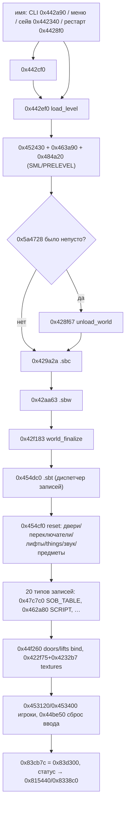

# Загрузка и выгрузка уровня: `.sbw`, `.sbt`, `.sbc`, `SOB_TABLE` (M2.2.3)

**Статус:** карта собрана по `gundx.exe` v1.36 (ImageBase `0x400000`) без запуска
игры: декомпилятор/дизассемблер Ghidra + `objdump` (`tools/ghidra/mcp.py`,
`tools/re/disrange.py`). Всё проверяется машинно:
`python3 tools/re/level_load.py --verify` (143 проверки: байты exe, строки,
call-рёбра, jump-таблица SBT, файлы `level0`/`dm1` и весь корпус из 36 уровней),
`--self-test` — автотест на синтетическом PE и синтетических `.sbw/.sbt/.sbc`.

Форматы (`docs/FORMATS.md` §4, §10, §12), поля дверей/переключателей/лифтов
(`docs/DOOR_FIELDS.md`), экземпляры вещей (`docs/THING_FIELDS.md`), события
(`docs/EVENTS.md`), инициализация до уровня (`docs/INIT.md`), кадр
(`docs/MAINLOOP.md`) — не дублируются.

Пометки: **код** — шаг подтверждён байтами (адрес есть в `CODE_EDGES`/`IMM`
скрипта), **гипотеза** — вывод декомпилятора без байтового подтверждения.

## 1. Вся цепочка в одну строку

```
источник имени: CLI 0x442a90 / фронтенд 0x48dc12 / сейв 0x442340 / рестарт 0x4428f0
  → 0x442cf0 game_start_level (сеть, режим) или 0x442ef0 напрямую
      → 0x442ef0 load_level:
          имя 0x5a47c8 → 0x5a4728
          → 0x452430/0x463a90/0x484a20 (сброс игрока, VM, экран загрузки)
          → [если прежнее имя] 0x428f67 unload_world
          → 0x429a2a  <level>.sbc      (лайтмапы, warning при отсутствии)
          → 0x42aa63  <level>.sbw      (fallback 0x42a33d — текст)
          → 0x42f183  world_finalize   (порталы, AABB)
          → 0x454dc0  <level>.sbt      (fallback 0x454b00 — текст)
              → 0x454cf0 reset → 20 записей → 0x44f000/0x44e540/0x46fd90/…/0x462a80
          → 0x44f260 привязка дверей/лифтов, 0x422f75+0x4232b7 текстуры
          → 0x453120/0x453400 игроки, 0x44be50 сброс управления
          → 0x83cb7c = 0x83d300; статус → 0x815440/0x8338c0
```



## 2. Три входа и переход из кадра

| вход | адрес | что делает | доказательство |
|---|---|---|---|
| CLI | `0x442a90` | первый не-флаговый аргумент → имя `0x5a4778`, `[0x4ab30c] = 0` | `docs/INIT.md` §5, xref `0x5a4778` |
| меню/фронтенд | `0x48dc12` → `0x48b0c0` | выбор уровня: `0x5a4778` | xref `0x5a4778` |
| кадр `0x44c230` | `0x44c2ab` | отложенное имя `0x5a47c8`: если `[0x83d620] == 0` → сразу `0x442ef0`, иначе перенос в `0x5a4778`; `0x44c2fd`: `0x5a4778` непусто → `0x442cf0`; ошибка → `[0x4bc440] = 5`, `[0x83cb7c] = 0` | код (`0x44c29d`…`0x44c318`) |
| рестарт | `0x48da0b` → `0x4428f0(mode)` | текущий уровень заново, статус игрока восстанавливается | код |
| сейв | `0x48db6c`, `0x495194` → `0x442340(id)` | `savegame\saved<id>.SBT/.SBW` | код |

`0x442cf0 game_start_level` (код): копирует `0x83d63c→0x83d180` (число игроков),
`0x83d19c→0x83d620`, `0x83d2d8→0x83d62c`, `0x83d624→0x83d2c8`,
`0x83d188→0x83d184`, `0x83d194→0x83d18c`, `0x83d198→0x83d310`, сетевые режимы
(`0x4641f0`), затем имя `0x5a4778 → 0x5a47c8`, обнуляет `0x5a4868`/`0x5a48b8`
и вызывает `0x442ef0`; при ошибке → `0x83d18c = 0`.

## 3. `0x442ef0` — шаги загрузки

Полная таблица печатается `python3 tools/re/level_load.py`; ниже — то же с
пояснениями. `S*` — порядок исполнения, `S5b/S7b` — фолбэки.

| шаг | адрес | что | файл/буфер | глобалы | ошибка |
|---|---|---|---|---|---|
| S0 | `0x442ef0` | имя `0x5a47c8` → `0x5a4728`; два `double` 1.0 → `0x4aa390`/`0x4aa398`, `0x5a4700` = 0 | — | `0x5a4728`, `0x5a4700` | — |
| S1 | `0x442f5a` | `0x452430` (статус игрока), `0x463a90` (VM), `0x484a20` (экран загрузки: `frontend/LOADPAGE` и `SML\PRELEVEL\<уровень>.SML`) | `FRONTEND`, `SML` | `0x619aa8..b0` | — |
| S2 | `0x442f7f` | если прежнее имя непусто → `0x428f67` unload_world | — | см. §6 | — |
| S3 | `0x442fa6` | стоп/старт музыки, если `[0x4aa384]`: `0x40c030`, `0x40bcf0`, `0x48f770` | `MUSIC` | — | — |
| S4 | `0x442fff` | `0x429a2a("", "<level>")` — SBC | `<level>.sbc` | `0x5a45c8` count, `0x5a45cc` массив (8 Б/запись) | `0x4ab62c` **warning** |
| S5 | `0x44304b` | `0x42aa63("", "<level>")` — SBW (binary) | `<level>.sbw` | `0x76ed40` (0x800×0x10), `0x5310c0`, `0x5670cc`, `0x5670d8/dc`, `0x5670e0/e4` | `0x4ab98c`+`0x4ab5e4`, код `0xfffffffe` |
| S5b | `0x443078` | `0x42a33d` — текстовый SBW | `<level>.sbw` | как S5 | `0x4ab98c`+`0x4ab5e4` |
| S6 | `0x4430cc` | `0x42f183` world_finalize: слияние копланарных порталов (`0x42f46a`), пересчёт AABB (`0x43529f`), `0x42d045` | — | `0x5670d8` объекты, `0x7ff9/0x7ff8` в полигонах | `0x4ab970`+`0x4ab948`, код `0xfffffffe` |
| S7 | `0x44312c` | `0x454dc0("<level>.SBT", 0)` — things-only режим | `<level>.sbt` | все массивы из §4 | `0x4ab910`+`0x4ab56c`, код `0xfffffffd` |
| S7b | `0x443155` | `0x454b00("<level>.SOT", 0)` — текстовый | `<level>.sot` | как S7 | то же |
| S7c | `0x4431d9` | при `[0x5a46dc]` (`/sbm`): `0x42afbb` пишет `.sbw`, `0x455760` пишет `.sbt` | `<level>.sbw/.sbt` (запись) | — | `0x4ab8e0`/`0x4ab8ac` (не фатально) |
| S8 | `0x443253` | `generate_runner(-5)`, `(-6)`, `0x4847f0`, `0x44f260` (bbox дверей `0x44dfc0`, лифты `0x44e6f0`) | SCRIPT | `0x83d2d0/0x83d2d4` | — |
| S8b | `0x443299` | `generate_runner(-4)`, `(-2)`, `(0)`, `(-1)`; `0x5a46e4 = 0`, `0x5a46e8 = тик` | SCRIPT | `0x5a46e4/e8` | — |
| S9 | `0x4432fa` | `0x422f75("textures", 0)`, `0x422f75("sprites", 1)` | `PICS/*.sbm` | пул текстур | `0x4ab528`, код `0xfffffffa` |
| S10 | `0x443387` | `0x4232b7`: слить имена секторов `0x76ed40` в пул `0x55a0c0` | — | `0x5330c0`, `0x5350c0`, `0x55a0c0` | `0x4ab528` |
| S11 | `0x4433c3` | `0x455f30`: обновление спрайтов | спрайты | `0x5a9728` | `0x4ab50c`, код `0xfffffff9` |
| S12 | `0x443449` | игроки `0x453120(0x83d2d0)` / `(0x83d2d4)` по `[0x83d180]` | — | `0x83d2d0/d4`, `0x83d308/30c` | `0x4ab87c`/`0x4ab844`, код `0xfffffffd` |
| S13 | `0x4434fa` | `0x453400` → `0x83d308/0x83d30c` | — | `0x83d308/30c` | — |
| S14 | `0x44351a` | цикл: 8 слотов статуса `0x81c370`, шаг `0x3510`, до `0x836bf0` ← 0 | — | `0x81c370..0x836bf0` | — |
| S15 | `0x443565` | `0x44be50(0)` и `0x44be50(1)` — сброс ввода/управления игроков | — | `0x5a49f0..6c`, `0x5a4958..d4` | — |
| S16 | `0x4435c2` | `[0x83cb7c] = [0x83d300]`; при `0x83d300 == 4` → `generate_runner(-20)` | SCRIPT | `0x83cb7c` | — |
| S17 | `0x4435ef` | `strnicmp(имя,"SAVEGAME")==0` → выход; иначе копия `0x3510` Б `0x819040`: при имени `"LEVEL0"` → `0x815440`/`0x5a4868`, иначе → `0x8338c0`/`0x5a48b8` | — | `0x819040`, `0x815440`, `0x8338c0` | — |

`0x4aa394/0x4aa39c = 0x3ff00000` (1.0 как старшая половина double) и
`0x4aa390/0x4aa398 = 0` — масштабы времени/анимации кадра.

## 4. SBT: тип записи → обработчик (доказано jump-таблицей)

Диспетчер `0x454dc0`: `push <файл>` → `0x40dae0` open → 80 байт magic +
`u32 version` (должен быть 0) → байт типа → `lea eax,[edx-1]`,
`cmp eax,0xfe`, `mov cl,[eax+0x455658]`, `jmp [ecx*4+0x455604]` (`0x45516f`…).
Поэтому таблица ниже не «по документации», а **выведена из exe**
(`--verify` сверяет каждый обработчик первым `call` в теле case).

| тип | обработчик | нагрузка | куда |
|---|---|---|---|
| 1 | `0x44f000` | `u32 n ≤ 0x200` + `n*0x20` | `0x5a945c`, `0x5a4af0` |
| 2 | `0x44e540` | `u32 n < 0x65` + `n*0xB8` | `0x5a9450`, `0x8381a0` |
| 3 | `0x46fd90` | `u8 exists` + `0x528` | `0x7ac080` (260×0x528) |
| 4 | `0x47e000` | `u32 n ≤ 0x80` + `n*936` | THING_TYPES |
| 5 | `0x468ef0` | `u32 n ≤ 0x31` + `n*52` | `0x62cad0`, `0x62c0a8` |
| 6 | `0x4564b0` | `u32 n ≤ 0x1f3` + `n*44` | SPRITES |
| 7 | `0x46b280` | `u32 n ≤ 0x7f` + `28n` | `0x800340/0x800540/0x800140` |
| 8 | `0x46b7b0` | `0x5800` | SECTOR_STUFF |
| 9 | `0x451c20` | `u8` + `0x3510` | `0x81c23c..`, `0x819040` |
| 10 | `0x4971b0` | заглушка, `-1` (не поддерживается) | — |
| 11 | `0x462a80` | things + 3 колонки + код + `9*0x400` | `0x5b1df0`, `0x5b0df0/0x5e4680/0x616658`, `0x5e2dd0`, `0x4b6784`, `0x80d87c/d8e0` |
| 12 | `0x40b670` | `300*u32 + 300*9` | таблица сэмплов |
| 13 | `0x4971b0` | заглушка, `-1` | — |
| 15 | `0x4633a0` | `u32 n < 0x1f4`, 4 колонки | `0x5b21f8..` |
| 16 | `0x463680` | `u32 n < 0x12c`, 3 колонки | `0x618b88..` |
| 17 | `0x463900` | `u32 n < 0x100`, 2 колонки | `0x5e5680..` |
| 18 | `0x44ec20` | `u32 n ≤ 0x1e` (`n*0xA8`) + `u32 k ≤ 0xC8` (`k*12`) | `0x5a9454`, `0x836de0`, `0x5a9458`, `0x5a9130/0x5a8e10/0x5a8af0` |
| 19 | `0x468df0` | `0x7080`, только при `[0x83d620] != 1` | `0x806360`, `0x806398` (300×0x60) |
| 20 | `0x47c7c0` | `u32 n ≤ 0xC8` + `n*0x14` | `0x638128`, `0x637188` |
| остальные 14, 21..254 | `0x4555ae` | «World Things file (%s) corrupt. Last keyword=%ld.» → код `0xfffffff1` | — |
| 255 | `0x455189` | конец файла | — |

Режим `param_2` у `0x454dc0`:
`0` — уровень (`<level>.SBT`): типы 1, 2, 3, 8, 9, 10, 13, 19 отвергаются
(`0xfffffff2`) — это блоки состояния сейва;
`1` — сейв (`savegame\saved<id>.SBT`): разрешены все.
Отсюда: **в поставочных `.sbt` нет дверей/переключателей/лифтов/things** — они
создаются скриптом (`ADD_DOOR`/`ADD_SWITCH`/`ADD_LIFT`/`ADD_THING*`), а
записи типов 1/2/3/9/18/19 есть только в сейвах (§12 `docs/FORMATS.md`).

### `0x454cf0` — предварительный сброс (перед чтением записей)

```
0x454cf0  call 0x47c7b0   ; SOB_TABLE: count 0x638128 = 0
0x454cf5  call 0x44dfa0   ; count дверей/переключателей/лифтов/остановок = 0
0x454cfa  call 0x455f00   ; таблица спрайтов: 0x5a9728 = 0, 0x5a9768..0x5ab838 ← 0 (шаг 0x54)
0x454cff  call 0x46c7d0   ; things: 0x7ac3bc.. ← 0 (260×0x528), 0x7ab9f8, 0x7ffd20..34
0x454d04  call 0x4971c0   ; заглушка (возвращает 0) — вызывается дважды
0x454d09  call 0x4971c0   ;
0x454d0e  call 0x46b1b0   ; источники звука: 0x800740 = 0, 0x800b60.. ← 0
0x454d13  call 0x456f50   ; эффекты/анимации: 0x5e3dec = 0x1a, …
0x454d18  jmp  0x468490   ; предметы: 0x806398 ← 0xfffffffe (300×0x60), 0x62cad0 = 0
```

## 5. Runtime-массивы, которые заполняет загрузка

Полная таблица — `python3 tools/re/level_load.py --globals`. Ключевое:

| массив | адрес | шаг/лимит | счётчик | пишет |
|---|---|---|---|---|
| двери | `0x8381a0` | `0xB8`, 100 | `0x5a9450` | `0x44e540` (SBT 2) / `ADD_DOOR` `0x44e250` |
| переключатели | `0x5a4af0` | `0x20`, 512 | `0x5a945c` | `0x44f000` (SBT 1) / `ADD_SWITCH` `0x44e5f0` |
| лифты | `0x836de0` | `0xA8`, 30 | `0x5a9454` | `0x44ec20` (SBT 18) / `ADD_LIFT` |
| остановки лифтов | `0x5a9130/0x5a8e10/0x5a8af0` | `4`, 200 | `0x5a9458` | `0x44ec20` |
| вещи (things) | `0x7ac080` | `0x528`, 260 | курсор `0x46d5e0` | `0x46fd90` (SBT 3) / `ADD_THING*` `0x46d000` |
| предметы | `0x806398` | `0x60`, 300 | `0x62cad0` | `0x468df0` (SBT 19) / `ADD_ITEM` |
| SOB_TABLE | `0x637188` | `0x14`, 200 | `0x638128` | `0x47c7c0` (SBT 20) |
| объекты мира | `0x5670d8` | `0x18`/сектор | `0x5670dc` | `0x42aa63` (SBW) |
| материалы | `0x5670e0` | `0x40` | `0x5670e4` | `0x42aa63` |
| таблица текстур секторов | `0x76ed40` | `0x10`, 0x800 | — | `0x42aa63`, пул — `0x4232b7` |
| лайтмапы | `0x5a45cc` | 8 Б, n | `0x5a45c8` | `0x429a2a` (SBC) |
| скрипты | `0x5b0df0`/`0x5e4680`/`0x616658` | `4`×3 колонки, 0x400 | `0x5b1df0` | `0x462a80` (SBT 11) |
| location handle | `0x80d8e0` | `0x28`, 200 | `0x80d87c` | `0x462a80` |
| свет локальный | `0x638330` | `0x50`, 1000 | `0x64bbb4` | `ADD_LIGHT_SOURCE` (87) |
| свет небесный | `0x638130` | `0x20`, 16 | `0x64bbb0` | `ADD_SKY_LIGHT_SOURCE` (88) |
| статус игроков | `0x81c370` | `0x3510`, 8 слотов | `0x83d180` | S14 |

`SOB_TABLE` (`0x47c7c0`) резолвит модели сразу: каждая запись
`{char name[12]; u32 amount; u32 ptr}` проходит через `0x42b4e1` (SOB или SOO по
имени); неудача → `Unable to load SOB or SOO %s\n` (`0x4bb29c`), запись остаётся
с `ptr = 0`. Это тот же путь, которым пользуется `THING_TYPES+0x1a4` (§12.3
`docs/FORMATS.md`).

## 6. Выгрузка

Две функции, разные по назначению:

| функция | адрес | когда | что делает |
|---|---|---|---|
| `unload_world` | `0x428f67` | начало `0x442ef0`/`0x442340`, при пустом `0x5a4728` не вызывается | освобождает **геометрию и мир** |
| `reset` | `0x454cf0` | начало `0x454dc0` (перед чтением записей) | обнуляет **логические массивы** |

`0x428f67` по шагам:

```
for i in 0..0x7FF:                                     ; 0x428f67…
    if u16[0x5350c0 + i*2] != 0:                       ; текстура использована
        0x4805a0(&0x55a0c0 + (id-1)*0x10, &0x76ed40 + i*0x10, 7)  ; снять ссылку
memset(0x5310c0, 0, 0x2000)   ; счётчики ссылок текстур (0x800 dword)
memset(0x76ed40, 0, 0x8000)   ; таблица текстур секторов (0x800 × 0x10)
memset(0x5350c0, 0, 0x1000)   ; remap текстур (0x800 word)
0x42267a  ; 0x5670cc = 0 (число эффектов)
0x428e98  ; 0x5a45d0 = 0
0x428e68  ; free 0x5a45cc (лайтмапы), 0x5a45c8 = 0
0x428d6b  ; free таблицы 0x6ebd24 (шаг 0x10, count 0x5a45c4) + count = 0
0x422e9a  ; free объекты: 0x5670d8 (по 0x422c7a), count 0x5670dc = 0
0x41e5e0  ; free 10 указателей 0x5670e8..0x567124 + счётчики
0x428dd0  ; free объекты 0x71cd40 (0x422ab6)
0x433d80  ; free структуры 0x5745b0
0x420bd3  ; free 0x5670e0 (материалы), 0x5670e4 = 0
0x5a45c0/bc/b8/b4/b0 = 0
```

**Что НЕ чистится при выгрузке мира:** массивы дверей (`0x8381a0`),
переключателей (`0x5a4af0`), лифтов (`0x836de0`), things (`0x7ac080`),
предметов (`0x806398`), `SOB_TABLE` (`0x637188`), скриптов и света. Их
обнуляют только счётчики — и то в `0x454cf0`, т.е. **только при загрузке `.sbt`**.
Если уровень грузится без `.sbt` (фолбэк/ошибка), старые записи остаются в
памяти с обнулёнными счётчиками — потенциальный «мусор», но читатели ходят по
счётчику, поэтому наружу это не выходит. Сами массивы — статические (`.data`),
не malloc, поэтому «утечки» памяти нет; освобождаются только указатели мира и
лайтмапов.

Записи типа 3 (`THING`) при загрузке **сначала** обнуляют весь массив
`0x7ac3bc..0x800060` (цикл `0x46fd9c`…`0x46fdb3`, шаг `0x528`), затем читают
260 флагов «exists».

## 7. Повторная загрузка (смена уровня без рестарта)

1. Имя нового уровня кладётся в `0x5a4778` (CLI/меню) или `0x5a47c8`
   (прямой запрос из кадра). Кадр `0x44c230` разбирает оба слота (§2).
2. `0x442cf0`/`0x4428f0` переносят имя в `0x5a47c8` и вызывают `0x442ef0`.
3. `0x442ef0` видит непустой `0x5a4728` (прежний уровень) и вызывает
   `0x428f67` — мир выгружается. Далее всё как при первой загрузке.
4. **Рестарт того же уровня** `0x4428f0(mode)`: имя берётся из `0x5a48b8`
   (mode&1) или `0x5a4868`, статус игрока копируется из `0x815440`
   («продолжение») или `0x8338c0` (шаблон новой игры) → `0x819040`
   (0x3510 Б, `docs/FORMATS.md` §15), `[0x83d300] = mode&2 ? 2 : 4`, затем
   `0x442ef0`.
   `0x83d300` — режим спавна: при `4` `0x442ef0` в S16 делает
   `generate_runner(-20)`.
5. **Смена уровня из игры** (не рестарт) идёт через `0x442cf0`: он
   предварительно останавливает сеть (`0x4641f0`/`0x468450`/`0x4640c0`),
   переписывает параметры матча (`0x83d180`, `0x83d620`, …), и только потом
   грузит мир.
6. Ошибка любого шага → `[0x83d18c] = 0` (в `0x442cf0`) или
   `[0x4bc440] = 5`, `[0x83cb7c] = 0` (в кадре) — игра уходит в состояние
   ошибки, а не продолжает со старым уровнем.

**Что течёт между загрузками:** ничего из мира (всё free/memset), но
`0x83d2d0/0x83d2d4` (указатели игроков), `0x83d308/0x83d30c` (контроллеры) и
слоты статуса `0x81c370` переинициализируются, а не освобождаются — это
статические структуры. Кэш текстур (`0x55a0c0`, пул) между уровнями
**сохраняется** (refcount снимается в `0x428f67`, но сами сэмплы/текстуры
остаются в пуле до `0x422f75` следующего уровня).

## 8. Связь с загрузкой сейва (`0x442340`, `0x455e60`, `0x451c20`/`0x452020`)

| шаг | адрес | что |
|---|---|---|
| V0 | `0x442340` | `game_load_save(id)`: имя `savegame\saved<id>` в `0x5a4728` |
| V1 | `0x4423a7` | `0x428f67` unload_world, если был уровень |
| V2 | `0x442436` → `0x455e60` | читает заголовок `savegame\saved<id>.SBT` (`0x50` magic, `u32` version, `0x50` **имя уровня**) → `0x5a4818` |
| V3 | `0x442476` | SBC сохранённого уровня `0x429a2a` |
| V4 | `0x4424d9` | SBW `0x42aa63("savegame","saved<id>")` |
| V5 | `0x44254d` | world_finalize `0x42f183` |
| V6 | `0x4425d2` | `0x454dc0("savegame\saved<id>.SBT", 1)` — **things-режим**: разрешены типы 1/2/3/9/18/19; заголовок расширен (`0x50` имя + ~22 `u32` параметров матча: `0x83d2c8`, `0x83d624`, `0x83d184`, `0x83d188`, `0x83d310`, `0x83d620`, `0x83d300`, `0x83d180`, `0x83d63c`, `0x83d62c`, `0x83d2d8`, `0x83d638`, `0x83d2c0`, `0x83d2e0[0x20]`, `0x4aa2d8[0x20]`, …) |
| V7 | `0x442643…` | далее как S8..S16, но статус игрока приходит из записи 9 |

Обратная сторона: запись сейва `0x455760` пишет `.SBT`
(`"BINARY SAVE"` + `version 0`) и вызывает `0x452020` для блока
`PLAYER_STATUS`; `0x452020` сериализует `0x3510` байт из `0x819040`
(`+0x3210` — флаг «exists» слота). `0x451c20` — парный загрузчик:
читает флаг, затем `0x3510` байт в слот `0x81c23c..`/`0x819040`, восстанавливая
привязки объектов через `0x47c990`/`0x4277cd`; ошибки —
`playerstatus_loadbin() unable to …` (`0x4ac77c`, `0x4ac744`, `0x4ac70c`,
`0x4ac8ec`, `0x4ac8a4`).

То есть «загрузка уровня» и «загрузка сейва» — **один и тот же конвейер**:
различаются только имена файлов (`<level>.*` против `savegame\saved<id>.*`) и
режим диспетчера (`param_2 = 0/1`), который запрещает/разрешает записи
состояния.

## 9. Ошибки и строки

| строка | адрес | где | код возврата |
|---|---|---|---|
| `Unable to load world file (%s).` | `0x4ab5e4` | SBW (`0x4430a1`) | `0xfffffffe` |
| `Unable to load world things file (%s).` | `0x4ab56c` | SBT (`0x443183`) | `0xfffffffd` |
| `Warning, unable to load level lightmaps (SBC file missing).` | `0x4ab62c` | SBC (`0x44300b`) | 0 (не ошибка) |
| `Unable to load world (%s)` / `Unable to load world things file (%s)` | `0x4ab98c` / `0x4ab910` | лог тех же ошибок | — |
| `Unable to engine_initall()` / `Unable to initalize rendering engine.` | `0x4ab970` / `0x4ab948` | `0x42f183` | `0xfffffffe` |
| `Unable to load textures.` | `0x4ab528` | `0x4232b7` | `0xfffffffa` |
| `Unable to update sprites.` | `0x4ab50c` | `0x455f30` | `0xfffffff9` |
| `Unable to create player 1\n` / `2\n` | `0x4ab87c` / `0x4ab844` | `0x453120` | `0xfffffffd` |
| `Unable to save binary world/thing file '%s'` | `0x4ab8e0` / `0x4ab8ac` | `/sbm` | не фатально |
| `World Things file (%s) corrupt. Last keyword=%ld.` | `0x4acac8` | диспетчер | `0xfffffff1` |
| `Unsupported SBT version number.` | `0x4acaa4` | заголовок | `0xfffffffe` |
| `Error reading SBT header (%s).` | `0x4accfc` | заголовок | `0xfffffffd`/`0xfffffffe` |
| `Switch/Door/Thing/Sector stuff/Player Status/Item encountered on things load` | `0x4acc24`/`0x4acbec`/`0x4acbb0`/`0x4acb34`/`0x4acc60`/`0x4acafc` | режим `param_2 = 0` | `0xfffffff2` |
| `No level loaded to restart from.` | `0x4ab6dc` | `0x4428f0` | `0xffffffff` |
| `Unable to initialize network for …` | `0x4ab784`/`0x4ab750` | `0x442cf0` | `-1` |

## 10. Сверка с C++ (`engine/src/`)

| шаг | C++ | покрыто тестом |
|---|---|---|
| S0 имя/`0x5a4728` | `gm::Options::level` (`core/config.cpp` `--level`) | — |
| S4 SBC | `gm::parse_sbc` (`res/sbc.cpp`), `gm::load_level` (`res/level.cpp`) | `test_fuzz` (синтетика) |
| S5 SBW | `gm::parse_sbw` (`res/sbw.cpp`) | `test_collide` (реальные), `test_fuzz`, `test_doors` через `load_real` |
| S6 world_finalize (порталы) | **нет** — рендер работает по полигонам напрямую | — |
| S7 SBT диспетчер | `gm::parse_sbt` (`res/sbt.cpp`) — все 20 типов записей | `test_sbtvm`, `test_doors`, `test_things`, `test_ai` (реальные) |
| S7 типы 4 (THING_TYPES) + 20 (SOB_TABLE) | `SbtLevel::sobs`, `resolve_types()` (`world/things.cpp`) | `test_things` |
| S7 тип 11 SCRIPT | `res/sbtvm.cpp` (дизассемблер), `res/vm_exec.cpp` (исполнитель), `res/scene.cpp` (`extract_scene`) | `test_sbtvm` (golden), `test_vm_exec`, `test_main`, `test_camera` |
| S7 типы 1/2/18 → массивы | `WorldState::build` (`world/doors.cpp`): **сначала записи 1/2/18, иначе `extract_scene`** | `test_doors` (корпус: 1779/3964/45) |
| S7 тип 3 THING → `0x7ac080` | ⚠ записи 3 в поставочных `.sbt` нет; `world/things.cpp` строит things из `extract_scene` | `test_things` (корпус) |
| S7 тип 9 PLAYER_STATUS | `res/save.cpp` (`SaveGame`), блок player status | `test_save`, `test_save_blocks`, `test_save_writer` |
| S8..S8b генераторы/системные скрипты | `res/vm_exec.cpp` + `game/events.cpp`, частично | `test_vm_exec`, `test_events` |
| S9/S10/S11 текстуры и спрайты | `res/sbm.cpp`, `render/*` (`--render`), пул — `res/cache.cpp` | `--render` вручную, `test_sprite` |
| S12/S13 игроки | `player/controller.cpp` | `test_player_controller` (синтетика) |
| S14 статус-слоты | `game/state.cpp` (частично) | `test_game_state` |
| S15 сброс управления | `game/state.cpp` / `input` | `test_controls` |
| S16 `0x83cb7c`/`0x83d300` | `game/state.cpp` (режимы), `docs/MAINLOOP.md` §4 | `test_game_state` |
| S17 копии статуса | **нет** | — |
| §6 unload (0x428f67) | **нет** — `gm::load_level` просто отпускает `LevelBundle` | — |
| §7 повторная загрузка | **нет** — один `load_level` за запуск; `--level` один раз | — |
| §8 сейв-конвейер (V0..V7) | `res/save.cpp` читает блоки, но не грузит мир по имени сейва | `test_save*` |

Итог: **форматы, записи 1/2/18 и сцена покрыты; жизненный цикл — нет.**
`WorldState::build` — единственное место, где C++ повторяет движковую схему
«запись → runtime-массив», но у него нет ни выгрузки (`0x428f67`), ни
повторной загрузки, ни сборки things из записи 3 (в поставочных `.sbt` её нет,
поэтому сцена берётся из скрипта).

## 11. Проверка на данных

`python3 tools/re/level_load.py --verify` (143 проверки, все проходят):

| метрика | `level0` | `dm1` | источник |
|---|---|---|---|
| `.sbw` размер | 254 439 | 1 008 875 | файл |
| текстуры / эффекты | 381 / 37 | 497 / 36 | парсер |
| секторы / объекты | 58 / 192 | 83 / 802 | парсер |
| вершины / полигоны | 2173 / 1449 | 9367 / 5786 | парсер, ровно до EOF |
| `.sbt` размер / записей | 127 338 / 8 | 151 516 / 9 | `[12,20,15,(16,)17,5,4,11,255]` |
| код SCRIPT | 62 497 Б, до EOF | 83 990 Б, до EOF | байткод разобран целиком |
| свет / спавны | **29 / 8** | 60 / 13 | байткод (опкоды 87+88 / 169+168) |
| двери / переключатели / лифты | 25 / 24 / 0 | 61 / 129 / 0 | `ADD_*` |
| location handle | 10 | 8 | `ADD_LOCATION` |
| `.sbc` | SBC1, 405 лайтмапов, 53 420 Б | SBC1, 1665, 308 484 Б | парсер |
| **корпус (36 уровней)** | двери **1779**, переключатели **3964**, лифты **45** | | сумма по всем `.sbt` |

Числа `1779/3964/45` и `29/8` совпадают с `docs/BASELINE.md`,
`docs/DOOR_FIELDS.md` и `gm.py scene` — то есть независимый (Ghidra-таблица
опкодов) разбор байткода даёт тот же результат, что Python-оракул.

## 12. Доказано / гипотеза / осталось

**Доказано (байты, проверяется `--verify`):**

* вход `0x442ef0`, порядок шагов и адреса вызовов S2…S17;
* SBC `0x429a2a` (magic `SBC0`/`SBC1`, строки `sbc`), SBW `0x42aa63`
  (строки `sbw`), SBT `0x454dc0` (jump-таблица `0x455604`+`0x455658`);
* лимиты: двери 100 (`cmp eax,0x64`), переключатели 512
  (`cmp eax,0x200`), лифты 30 (`cmp ecx,0x1e`), SOB_TABLE 200
  (`cmp eax,0xc8`), скрипты 1024 (`cmp eax,0x400`), код 0x30000;
* массивы: `0x8381a0`/`0x5a9450`, `0x5a4af0`/`0x5a945c`, `0x836de0`/`0x5a9454`,
  `0x7ac080` (260×0x528), `0x806398` (300×0x60), `0x638128`/`0x637188`,
  `0x5b1df0`, `0x80d87c`/`0x80d8e0`, `0x81c370` (8×0x3510);
* `0x442340`/`0x455e60` (сейв: имя уровня из заголовка), `0x451c20`/`0x452020`
  (PLAYER_STATUS 0x3510);
* ошибки и коды возврата §9.

**Гипотезы:**

* Выбор буфера в S17 по `strnicmp(имя,"LEVEL0",6)`. Сами буферы известны:
  `0x815440` — «продолжение» (его читает `0x4428f0`), `0x8338c0` — шаблон новой
  игры (`docs/FORMATS.md` §15); известно и то, что пары игрока в сейвах имеют
  заголовки `"LEVEL0"` и `""` (`res/save.h`, `SavePlayer::pair_headers`).
  Почему условием стало именно имя уровня, а не ярлык пары, — не доказано.
* `0x4acd1c` — флаг «ресурсы уровня подняты» (0 перед текстурами, 1 после);
  читателей не искали.
* Роли `0x452430`, `0x463a90`, `0x455f00`, `0x456f50` — «сброс состояния
  игрока/VM/спрайтов/эффектов» по записываемым адресам, без трассы.
* `0x480d10` — `_strnicmp` (регистронезависимое сравнение): цикл,
  case-folding латиницы, возврат 0 при равенстве.
* Пропуск `0x428f67` при пустом `0x5a4728` — проверено по коду, но «первый
  запуск всегда с пустым именем» — следствие `0x442cf0` (обнуляет
  `0x5a4868/0x5a48b8`) и `.data` = 0.

**Осталось:**

* Трасса порядка кадров загрузки (`0x484820` — прогресс-бар 0x2c2c2c2c,
  `0x4848b0` — отрисовка) — сколько кадров и когда обновляется экран.
* Полный разбор `0x42f183` (слияние порталов `0x42f46a`, метки `0x7ff8/0x7ff9`)
  — нужно для корректного рендера без «швов».
* `ADD_LIFT` (опкод 188) в C++ не собирается в лифты (`docs/DOOR_FIELDS.md`
  §3) — там же открытый вопрос о раскладке.
* Порядок `generate_runner(-5/-6/-4/-2/0/-1/-20)`: какие системные скрипты
  исполняются до первого кадра и что именно они инициализируют.

## 13. Воспроизведение

```sh
cd ~/gunmetal-re
python3 tools/re/level_load.py                # таблица шагов 0x442ef0/0x442340/0x4428f0
python3 tools/re/level_load.py --globals      # runtime-массивы
python3 tools/re/level_load.py --records      # SBT: тип -> обработчик
python3 tools/re/level_load.py --verify       # 143 проверки: exe + level0/dm1 + корпус
python3 tools/re/level_load.py --self-test    # автотест (exit != 0 при провале)
GUNMETAL_EXE=/path/gundx.exe GUNMETAL_DIR=/path python3 tools/re/level_load.py --verify

# точечно
python3 tools/re/disrange.py 0x442ef0 0x443690   # load_level целиком
python3 tools/re/disrange.py 0x454cf0 0x454d20   # reset перед SBT
python3 tools/re/disrange.py 0x455140 0x4551a5   # диспетчер SBT (jump-таблица)
python3 tools/ghidra/mcp.py decompile 0x428f67 0x429a2a 0x42aa63 0x454dc0 0x442340 0x4428f0
python3 tools/ghidra/mcp.py xrefs 0x5a4728
```
